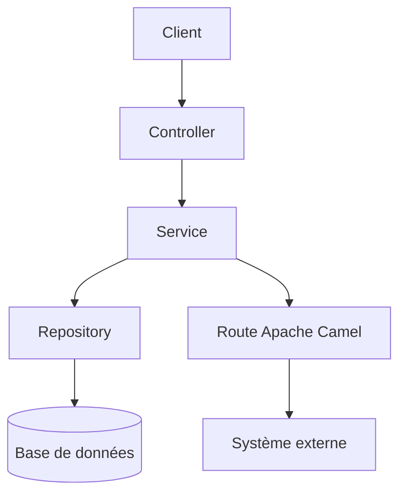

# Architecture du projet

> Document vivant maintenu par l'agent **Architect**. Toute évolution
> structurelle notable (nouveau module, nouveau repo lié, nouveau composant)
> doit être répercutée ici.

## 1. Vue d'ensemble

<!-- Résumer en quelques phrases le rôle de l'application, son domaine
métier, et son positionnement dans le système global. -->

- **Nom de l'application** :
- **Domaine métier** :
- **Type** : monolithe / multi-module Maven / microservice
- **Stack** : Java 21, Spring Boot 3, Apache Camel, Maven

## 2. Cartographie multi-repo

> À remplir uniquement si l'application fait partie d'un système composé de
> plusieurs dépôts Git. Sinon, indiquer "N/A — repo unique".

| Repo | Rôle / Responsabilité | Technologie | Dépendances (appelle / est appelé par) | Contrat d'interface |
|---|---|---|---|---|
| `<ce-repo>` | | | | |
| `<autre-repo>` | | | | |

### Flux inter-repos

<!-- Décrire les échanges entre dépôts : API REST synchrones, messages
asynchrones (Kafka, JMS, Camel), fichiers partagés, base de données
partagée, etc. Un diagramme Mermaid est recommandé. -->


## 3. Architecture interne (ce repo)

### Modules (si multi-module Maven)

| Module Maven | Package racine | Responsabilité |
|---|---|---|
| `<module>` | `com.<org>.<projet>.<module>` | |

> Si l'application est un module unique, indiquer "N/A — module unique" et
> se référer directement à `.copilot/rules/project-structure.md`.

### Couches applicatives

```
src/main/java/com/<org>/<projet>/
├── <domaine>/
│   ├── api/            # Contrôleurs REST
│   ├── service/        # Logique métier
│   ├── repository/     # Accès données (Spring Data JPA)
│   ├── model/          # Entités JPA
│   ├── dto/            # Objets d'échange (records)
│   ├── route/          # Routes Apache Camel
│   └── config/         # Configuration Spring
```

Le détail des règles de placement du code par fonctionnalité/domaine est
défini dans `.github/instructions/project-structure.instructions.md` —
**source de vérité** pour l'agent Architect et l'agent Dev.

## 4. Diagramme de composants



## 5. Décisions d'architecture (ADR courtes)

| Date | Décision | Justification |
|---|---|---|
| | | |

## 6. Références

- Spécifications fonctionnelles : `docs/specs/`
- Règles de placement du code : `.github/instructions/project-structure.instructions.md`
- Règles de style : `.github/instructions/code-style.instructions.md`
- Règles base de données : `.github/instructions/database.instructions.md`
- Règles sécurité : `.github/instructions/security.instructions.md`
