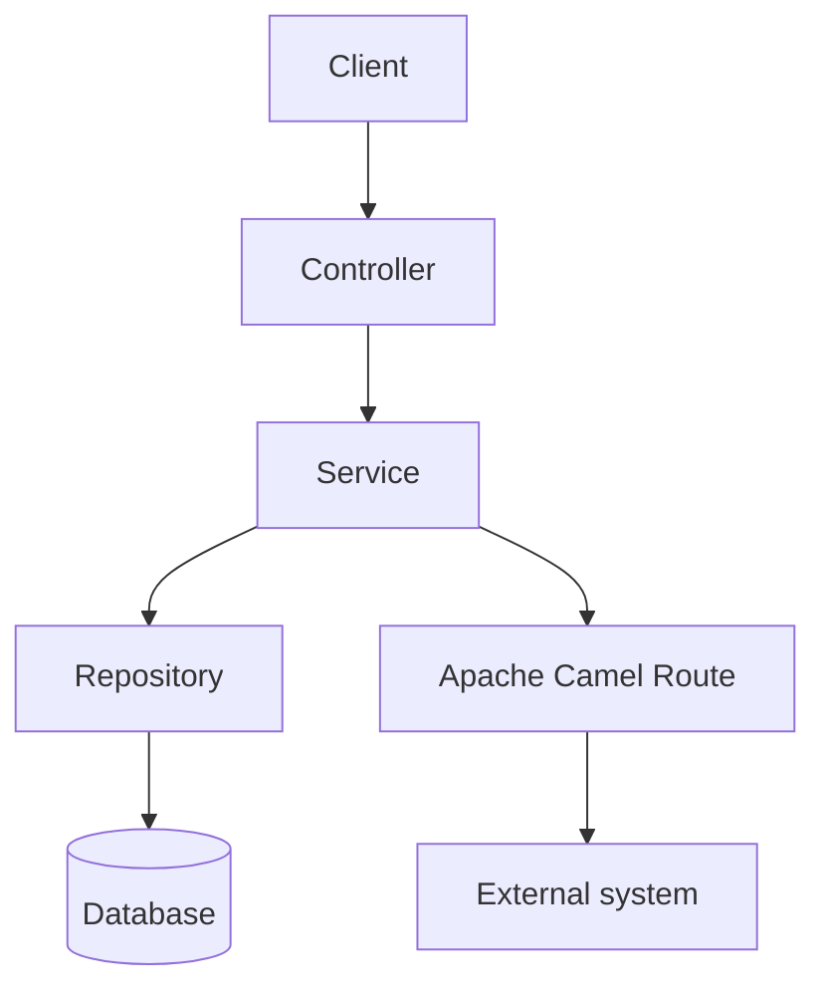

# Project Architecture

> Living document maintained by the **Architect** agent. Any notable
> structural change (new module, new linked repo, new component) must be
> reflected here.

## 1. Overview

<!-- Summarize in a few sentences the role of the application, its business
domain, and its position in the overall system. -->

- **Application name**:
- **Business domain**:
- **Type**: monolith / multi-module Maven / microservice
- **Stack**: Java 21, Spring Boot 3, Apache Camel, Maven

## 2. Multi-repo map

> To be filled in only if the application is part of a system made up of
> several Git repositories. Otherwise, write "N/A — single repo".

| Repo | Role / Responsibility | Technology | Dependencies (calls / is called by) | Interface contract |
|---|---|---|---|---|
| `<this-repo>` | | | | |
| `<other-repo>` | | | | |

### Inter-repo flows

<!-- Describe the exchanges between repositories: synchronous REST APIs,
asynchronous messages (Kafka, JMS, Camel), shared files, shared database,
etc. A Mermaid diagram is recommended. -->


## 3. Internal architecture (this repo)

### Modules (if multi-module Maven)

| Maven module | Root package | Responsibility |
|---|---|---|
| `<module>` | `com.<org>.<project>.<module>` | |

> If the application is a single module, write "N/A — single module" and
> refer directly to `.copilot/rules/project-structure.md`.

### Application layers

```
src/main/java/com/<org>/<project>/
├── <domain>/
│   ├── api/            # REST controllers
│   ├── service/        # Business logic
│   ├── repository/     # Data access (Spring Data JPA)
│   ├── model/          # JPA entities
│   ├── dto/            # Exchange objects (records)
│   ├── route/          # Apache Camel routes
│   └── config/         # Spring configuration
```

The details of the code placement rules per feature/domain are defined in
`.github/instructions/project-structure.instructions.md` — the **source of
truth** for the Architect agent and the Dev agent.

## 4. Component diagram



## 5. Architecture decisions (short ADRs)

| Date | Decision | Rationale |
|---|---|---|
| | | |

## 6. References

- Functional specifications: `docs/specs/`
- Code placement rules: `.github/instructions/project-structure.instructions.md`
- Style rules: `.github/instructions/code-style.instructions.md`
- Database rules: `.github/instructions/database.instructions.md`
- Security rules: `.github/instructions/security.instructions.md`
